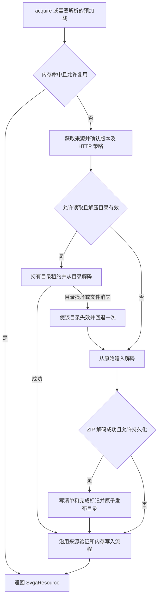

# SvgaEngine ZIP 解压缓存实现方案

日期：2026-11-08。状态：已实施，单元测试、APK 构建及真机集成测试均已通过。

为新版 `SvgaEngine` 增加可跨引擎实例和应用重启复用的 ZIP 解压目录缓存。首次成功加载时保存解压结果；后续加载在来源版本一致、磁盘读取策略允许且缓存完整时，直接从目录解析资源，跳过 ZIP 解压。

解压缓存沿用现有 `diskRead`、`diskWrite` 和 `diskBytes`，无需增加业务侧请求参数。远程来源仍先确认 HTTP 新鲜度，目录命中后仍按本次尺寸和解码选项生成 `SvgaResource`。

## 现有实现

| 位置 | 当前行为 | 本次实现涉及的调整 |
| --- | --- | --- |
| [SvgaEngine.kt](../../../svga-loader/src/main/java/com/opensource/svgaplayer/loader/SvgaEngine.kt) 的 `acquire`、`prepare` | 先查强弱内存缓存；未命中后获取来源，在 `staging/<UUID>` 解码，最终递归删除临时目录 | 在资源解码前查找解压缓存，成功的 ZIP 冷解码可发布目录 |
| 同文件的 `remote`、`diskSource` | `sources/<sourceIdentity>` 保存远程原始正文和 HTTP 元数据；磁盘命中时复制正文快照供本次使用 | 保留来源选择、快照和正文验证流程，关联同版本解压目录 |
| 同文件的 `trimDisk`、`clearDisk` | 容量统计和清理覆盖原始正文；`clearDisk` 还清理断点续传记录 | 纳入解压缓存、活动目录保护和清理期间的发布控制 |
| [SvgaResource.kt](../../../library/src/main/java/com/opensource/svgaplayer/SvgaResource.kt) 的 `decode` | ZIP 解压、电影数据解析和资源构建集中在同一方法 | 提取可直接读取已有目录的解码入口，共用资源构建逻辑 |
| [SvgaRequest.kt](../../../svga-loader/src/main/java/com/opensource/svgaplayer/loader/SvgaRequest.kt) | 来源身份、磁盘策略、刷新和只读缓存语义已经定义 | 复用现有请求字段 |

目前只有远程原始正文持久化；Assets 和本地文件没有额外的源文件副本。ZIP 每次资源冷解码都会重新解压，zlib 使用限长的流式 Protobuf 解码。

现有限制继续适用：输入最多 64 MiB、ZIP 解压累计最多 128 MiB、ZIP 条目最多 4096 个。单次资源解码仍遵循 `maxDecodedBytes`；`SvgaEngine` 当前构造参数默认值为 256 MiB。

旧版 `SVGAParser` 和 `SVGACache` 的解压目录不参与新版缓存查找，两个链路保持各自的缓存身份和生命周期。

## 加载流程



`preload`、`acquire` 和 `preDownload(parseAfterDownload = true)` 使用同一流程。默认的 `preDownload(parseAfterDownload = false)` 继续只准备原始来源，不查找或生成解压目录，不增加资源解码次数；Assets 仍需校验可读性和输入大小。

“直接加载”指跳过 ZIP 解压，从已展开的文件解析 movie、图片和音频。资源内存缓存未命中时，图片采样、帧数据构建和像素预算检查仍需执行。本期保留 `source()` 的远程正文快照和本地文件摘要计算，因此目录命中不代表完全没有原始文件 I/O；目录解码分支不再调用 `source.open()`。

## 缓存身份与版本

解压结果与展示尺寸无关，使用独立于资源内存缓存的键：

```text
zipKey = SHA-256(lengthPrefixed("zip-v1", sourceIdentity, sourceVersion))
```

字段按现有来源身份的长度前缀规则编码，避免拼接歧义。`zip-v1` 表示解压缓存格式版本；以后改变目录结构或兼容规则时升级版本。

| 来源 | sourceIdentity | 解压缓存的 sourceVersion |
| --- | --- | --- |
| Remote | 复用现有身份：完整 URL、显式 version、namespace、排序后的请求头 | 本次选定正文的 SHA-256，即现有 `Source.version` |
| LocalFile | 复用规范路径、长度、修改时间、显式 version、namespace 和请求头构造的身份 | 当前文件内容 SHA-256，即现有 `Source.version` |
| Asset | 复用包内路径、namespace 和请求头构造的身份 | 安装包标识摘要，而非直接复用现有常量 `"asset"` |

Asset 的安装包标识由包名、应用 versionCode、lastUpdateTime，以及按固定顺序排列的 base 和 split APK 路径、长度、修改时间组成。引擎创建时计算一次；用于识别安装包中固定的 Assets，应用更新或 APK 集合变化后不复用旧目录。如果无法取得可靠标识，本次引擎禁用 Assets 的持久解压缓存，仍按现有方式加载。

安装包标识只用于解压缓存键，不要求预读 Asset 正文计算摘要。首次冷加载继续只打开并读取一次 Asset；有效目录命中时不打开 Asset ZIP。包内资源在同一引擎生命周期内固定的前提与现有实现一致。

`width`、`height`、`bitmapConfig`、`renderScale`、`skipInvisibleImages`、`inBitmap` 和 `progressive` 不进入 `zipKey`。它们继续进入资源解码键，允许多个解码规格共用同一份展开文件，但分别创建适合本次请求的资源。

不同 namespace、鉴权请求头或显式来源版本继续隔离。磁盘元数据只保存来源身份摘要，不保存明文请求头或鉴权信息。

## 磁盘结构与就绪判断

```text
<context.cacheDir>/svga-engine/
  sources/
    <sourceIdentity>/
      body
      metadata
  unzipped/
    <zipKey>/
      metadata.json
      .complete
      content/
        movie.binary 或 movie.spec
        图片及其他 ZIP 文件
  staging/
    zip-<UUID>/
      content/
  partials/
```

解压缓存与 `sources` 分开存储，避免现有正文目录替换时误删可复用的解压结果。ZIP 条目只能写入 `content`，不能覆盖缓存自身的 `metadata.json` 或 `.complete`。

`metadata.json` 至少包含以下字段：

| 字段 | 含义 |
| --- | --- |
| `formatVersion` | 缓存格式版本，首版为 1 |
| `sourceIdentity`、`sourceVersion`、`sourceKind` | 绑定本次来源及版本，类型为 remote、file 或 asset |
| `generation` | 此次目录发布的唯一标识，供延迟失效操作精确定位 |
| `fileCount`、`expandedBytes` | 最终展开文件数量和总字节数，通过扫描暂存目录生成 |
| `files` | 展开文件的相对路径和实际长度清单 |

`.complete` 在 ZIP 全部读取完成、资源首次解码成功且清单写入完成后，作为最后一个文件写入暂存目录。随后在同一文件系统内将整个 `zip-<UUID>` 重命名为最终目录；不向最终目录逐个复制文件。

缓存命中必须同时满足：

1. 最终目录存在，`.complete` 是文件，元数据可解析，格式版本与来源身份、来源版本匹配。
2. `content` 中存在 `movie.binary` 或 `movie.spec`，优先选择 `movie.binary`，与当前解码顺序一致。
3. 清单中所有文件存在且长度一致；所有规范化路径均位于 `content` 内，不允许路径逃逸。
4. 清单文件数量等于 `fileCount` 且不超过 4096；文件长度之和等于 `expandedBytes` 且不超过 128 MiB。首次展开时仍需对实际 ZIP 条目数及累计输出单独执行现有上限检查。

目录存在本身不代表可用。缺少标记、movie、清单文件或格式不兼容时均按未命中处理。有效载荷发布后保持只读，LRU 时间更新在目录层处理。

清单用于检查文件缺失和截断，不要求每次命中重新计算所有文件摘要；内容解析失败的恢复规则见后文。

## 解码入口调整

在 `SvgaResource` 中增加 `decodeFromDirectory` 挂起入口，参数与现有 `decode` 的目录、尺寸、像素预算、解码选项和图片失败回调保持一致。

现有 `decode(InputStream, ...)` 保留签名。ZIP 分支完成解压后调用与 `decodeFromDirectory` 共用的资源构建逻辑；zlib 分支继续使用限长的流式解码。公共构建逻辑负责 movie 元数据检查、图片解析和采样、延迟图片字节保存、音频字节准备及帧路径构建，避免两个入口产生行为差异。

`library` 与 `svga-loader` 属于不同 Kotlin 模块，目录入口需要具备跨模块可见性，不能只声明为 `internal`。该入口服务于加载器集成，业务侧仍通过 `SvgaEngine` 加载。

目录入口不负责持久化、删除目录或修改缓存元数据。返回的 `SvgaResource` 继续独立持有 Bitmap、音频字节以及 progressive / inBitmap 所需的编码图片字节；返回后播放不能依赖缓存目录继续存在。

输入格式探测在同一个带缓冲的输入流上通过 mark / reset 完成，不为识别 ZIP 再打开一次来源，也不把完整 ZIP 读入 `ByteArray`。

## 引擎接入与目录发布

新增内部 `ZipDirectoryCache`，负责目录定位、完整性检查、租约、按键构建锁和原子发布；来源选择、HTTP 规则和资源内存策略仍由 `SvgaEngine` 负责。

`prepare` 保留现有资源键和 `resources` 共享任务。实际资源生产任务按以下顺序执行：

1. 根据来源身份和本次版本计算 `zipKey`；允许读取时尝试取得有效目录租约，再在 `decodes.withPermit` 内调用目录解码入口。
2. 缓存未命中且本次可写时，取得该键的构建锁，并在允许读取的前提下再次检查目录。其他尺寸的兼容请求可在等待后直接复用刚发布的目录。
3. 仍未命中时创建私有暂存目录，在解码并发许可内打开来源一次，探测格式并调用现有输入流解码。非 ZIP 不发布解压缓存；确认非 ZIP 后无需继续占用目录构建锁。
4. 资源解码成功后，沿用 `source.publish(true)` 完成来源验证；仅 ZIP 且符合持久化条件时生成清单和完成标记。
5. 在 `diskMutex` 内检查发布代次、来源当前版本和容量，再将暂存目录原子重命名到最终位置。远程来源必须仍有同 digest 的原始正文及元数据，才能发布对应目录。
6. 按现有方式为每个订阅者应用强弱内存写入策略。目录发布失败只影响后续复用，本次已经生成的资源正常返回。
7. `finally` 释放租约和构建锁，删除本次仍拥有的暂存目录。发布成功后不能把最终缓存目录作为临时目录删除。

临时目录创建沿用 `ensureSvgaDirectory`，每次使用前可恢复被系统清理的父目录。持久缓存路径不可写、被普通文件占用、容量不足或 rename 失败时，保留正常解码结果并跳过本次发布；不覆盖占位文件。

最终位置已有同版本有效目录时保留该目录，不删除后再覆盖。无效目录仍有活动租约时，先标记失效，延迟到租约释放后删除，本次可以只返回资源而不发布新目录。

## 缓存策略

| 条件 | 解压缓存读取 | 解压缓存写入及行为 |
| --- | --- | --- |
| ALL 或 DISK，未指定覆盖 | 允许 | 允许，受 HTTP 和容量限制 |
| MEMORY 或 NONE，未指定覆盖 | 禁止 | 禁止；允许本次解码所需临时文件 |
| `diskRead = false` | 禁止，包括取得构建锁后的二次检查 | 仍由 `writesDisk` 决定；本次从原始输入解码 |
| `diskWrite = false` | 仍由 `readsDisk` 决定 | 不新增或替换持久目录 |
| `diskBytes = 0` | 可按读取策略查找已有目录 | 不发布新目录，容量清理后不保证留存 |
| `refresh = true` | 绕过旧解压结果 | 重新获取来源并解压；成功后按写策略发布 |
| `cacheOnly = true` | 来源可用且允许磁盘读取时可复用 | 来源存在但解压目录缺失时可在本地重新解压，不访问网络 |
| 远程 `no-store` 或 `Vary: *` | 当前来源不可复用，不读解压缓存 | 不写解压缓存；允许磁盘写入时同时清理该身份的旧正文和解压缓存 |

最终开关使用 `SvgaRequest.readsDisk` / `writesDisk`，不能直接判断枚举值，避免忽略显式覆盖。读取时更新访问时间属于缓存维护；不把它当成发布新的持久化内容。

HTTP 判断在解压缓存查找前完成：新鲜正文可直接进入目录查找，过期正文需条件请求；304 且 digest 不变时可继续复用目录。200 返回不同正文时使用新 digest，不复用旧版本。`refresh` 即使获取到相同 digest，也执行本次解压，保持强制刷新语义。

`allowStaleOnError` 只有在现有远程来源流程选定过期正文后，才允许复用其同 digest 目录。解压缓存不单独决定 HTTP 过期、刷新或离线授权。

远程 `cacheOnly` 仍要求对应原始正文和元数据可用；孤立的解压目录不作为独立来源。本地文件和 Asset 继续允许在无网络情况下从自身来源加载。只下载的远程正文首次成功目录解码后，仍通过 `source.publish(true)` 升级 `validated`；不得绕过现有拒绝正文和晚到预下载结果的保护。

## 并发与取消

同引擎同解码规格沿用 `resources` 合并。同来源、同版本、不同解码规格的正常可读写请求，通过目录构建锁和锁内二次检查共用首次成功发布的解压目录。禁止读取、强制刷新或不允许持久化的请求按各自策略执行，不借用持久目录绕过开关。

同进程中指向同一规范缓存根目录的多个引擎必须共用目录构建锁、租约状态和清理代次。构建锁可用固定分片，避免锁表随来源数量无限增长。跨进程沿用现有能力边界，不承诺下载或解压去重；读取方仍需处理目录被其他进程移除的情况。

锁与并发许可遵循以下顺序：

- 构建任务先等待按键锁，再取得解码许可；等待按键锁时不占用解码许可。
- `diskMutex` 只覆盖目录状态、租约和发布清理事务，不在持有它时等待按键锁或执行资源解码。
- 目录读取在 `diskMutex` 内登记租约，离开锁后解码；内部淘汰和清理不能删除仍在读取的文件。
- 租约持续到目录解码返回或失败，不延续到动画播放；最后一个租约释放时执行延迟删除。

取消单个订阅者继续遵循 `SharedFlights` 的独立订阅语义。构建任务所属的资源共享任务在订阅者全部取消或引擎关闭时退出；其他资源规格的等待者可在取得锁后自行重试构建。未发布的目录删除，不留下可命中的完成标记。锁内等待者被取消后应及时退出。

仅在解码成功且发布前协程仍活动时发布目录。已经完成的原子发布可以保留，`close()` 继续只停止任务并清理内存，不清除可复用磁盘缓存。

## 容量与清理

`diskBytes` 作为完整来源缓存的共享预算，统计原始 `body`、来源 `metadata`、解压文件、解压元数据和完成标记的实际长度。暂存文件和断点续传记录沿用现有独立管理机制，不把 `diskBytes` 宣称为整个目录在所有时刻的物理占用硬上限。

远程正文与其解压目录按同一来源组成淘汰单元，使用任一部分都会更新该单元的访问时间。淘汰远程正文时同时使关联解压目录失效，避免保留无法选择来源的孤立目录；Assets 和本地文件的解压目录作为独立单元管理。

单个远程正文与解压目录合计超过预算时，优先保留可容纳的原始正文，放弃新增解压目录。本地文件或 Asset 的解压目录自身超出预算时同样跳过发布。已有活动租约导致容量暂时无法回收时，不为新解压目录扩大预算，待释放后再次执行清理。

正文 digest 更新成功后，可清理该身份已被替代的旧 digest 目录；同 digest 的 304 或元数据更新不得删除展开文件。清理和发布都在锁内核对当前版本，晚到的旧任务不能删除新版本目录，也不能为已被替代的远程正文发布孤立目录。来源元数据增加进程 session 和请求 revision，同进程中旧请求不能覆盖较新请求已发布的正文；来源验证升级保留当前 HTTP 元数据，资源内存写入也在同一事务锁下检查版本。

`clearDisk()` 扩展为同时清理来源、解压目录和现有断点续传记录。实现时增加按缓存根目录共享的清理代次：

1. 来源任务开始时记录代次，来源正文和解压目录发布时都核对该代次。
2. 清理事务推进代次，移除可见缓存。活动解压目录立即标记失效，停止接受新租约，文件延迟到已有租约释放后删除。
3. 清理前启动的任务可利用自身快照或租约完成本次加载，但不能随后把正文或解压目录重新写回。

引擎启动清理增加对解压缓存的检查：回收无效目录、旧格式目录，以及沿用现有一小时阈值判定的遗留暂存目录。同进程中登记为活动的构建目录不能仅因超过时间阈值被删除。系统删除整个缓存根目录后，下次加载仍可重建目录。

## 损坏恢复与失败处理

缓存清单无效、文件缺失，或目录解析表明 movie / 编码图片损坏时，使该 `zipKey` 的当前 `generation` 失效，并在同一次资源生产任务中回退到原始来源一次。需要重新构建时按相同键的构建锁协调；已有正文快照可用时不额外发起网络请求。

目录损坏本身不调用 `source.reject()`，避免误删完整的远程原始正文。原始来源解码失败才沿用现有正文拒绝流程；目录恢复场景需等原始来源重解码也失败后再拒绝正文。实现时把该处理限定在原始来源解码阶段，目录读取和缓存发布错误不能进入现有统一拒绝分支。取消、像素预算不足等与展开文件完整性无关的失败直接返回，不通过重新解压重试，也不因此删除有效目录。目录入口须区分可恢复的内容错误与请求预算错误，调用层不能用捕获所有 `Exception` 的方式决定重解压。

当前请求不允许磁盘写入时，损坏目录在本进程中标记为不可复用，本次用私有暂存目录恢复，不持久化修复；物理回收由后续允许的写入或显式清理完成。

progressive 延迟图片解码失败回调需要使内存资源和对应解压目录失效。从缓存目录构建的资源发生延迟图片失败时，保留原始正文，允许后续 `cacheOnly` 请求离线重新解压；只有从原始来源构建的资源也发生延迟图片失败时，才沿用同 digest 正文失效逻辑。回调只保留来源摘要、digest、目录 generation 及解码来源等必要身份，不能保留完整请求或 UI 回调；旧资源的延迟失败不能使新发布的同键目录或新正文版本失效。发布时如果保留已有同版本目录，回调须绑定该目录的实际 generation。

ZIP 解压继续保留路径穿越、输入长度、累计展开大小、条目数量和取消检查；从缓存目录加载时仍执行 movie 合法性、图片合法性及像素预算检查。缓存不得成为绕过这些限制的入口。

## 诊断与验收

保留现有计数器语义：`diskHits` 统计原始来源命中；`decodeCount` 统计实际进入解码的资源生产任务，目录命中仍会增加，同任务内部损坏回退不再增加一次。取消的排队任务不计入解码次数。强弱内存命中仍按现有计数器记录。

增加两个引擎诊断计数器：`zipCacheHits` 统计成功从持久目录完成的资源解码，`zipExtractCount` 统计实际开始的 ZIP 解压尝试，包括失败尝试。共享资源任务的跟随订阅者不重复计数，内存命中不计为目录命中。

验收以可观察行为为准，不用固定耗时阈值判断缓存是否生效：

| 场景 | 预期结果 |
| --- | --- |
| 首次 ZIP 加载，随后清理内存并重载 | 首次解压一次；第二次命中目录，解压次数不增加，资源正常解析 |
| 关闭引擎后用同一缓存根目录创建新引擎 | 同版本可从持久目录加载；远程仍按其新鲜度或 cacheOnly 决定是否请求网络 |
| 相同来源依次请求不同尺寸、配置或 renderScale | 共用展开目录，资源按各自参数构建，像素预算仍生效 |
| 多个兼容请求并发，解码规格不同 | 预算充足且首次解码成功时只解压一次；每种资源规格独立构建 |
| namespace、请求头、显式 version 或文件内容变化 | 使用不同缓存身份或版本，不误命中 |
| 应用安装包标识变化 | 旧 Asset 目录不命中；首次重新读取并解压 Asset |
| 磁盘读写四种组合及 NONE / MEMORY / DISK / ALL | 实际读取、发布和临时文件行为符合策略表；显式覆盖优先 |
| refresh、过期 304、200 新正文、stale fallback | 分别验证强制解压、同 digest 复用、新 digest 隔离和显式过期回退 |
| no-store、Vary 星号、diskBytes 为零或小于展开结果 | 不留下本次可复用解压结果，正常加载可成功 |
| 仅缓存且解压目录丢失，但原始正文完整 | 无网络重建；只有孤立解压目录时不能绕过远程来源缺失 |
| 默认预下载与开启解析的预下载 | 默认不生成目录、不解码；开启解析后可建立目录缓存 |
| movie、图片、标记或清单被删除及截断 | 拒绝命中并从原始来源最多恢复一次；完整正文不会因目录损坏被拒绝 |
| 路径穿越 ZIP、超限 ZIP 和无 movie 的 ZIP | 加载失败，无可命中的最终目录，临时目录可回收 |
| 单订阅者取消、所有订阅者取消及 close | 保留独立取消语义；未成功发布的目录不残留为有效缓存 |
| LRU、clearDisk 与目录解码并发，多引擎同时访问 | 内部操作不删除活动读取文件；释放后回收，清理前任务不能回写旧代次 |
| 清理或替换期间旧资源触发延迟图片失败 | 仅失效对应版本和发布 generation，不误伤新目录 |
| 资源返回后删除缓存，再播放 progressive / inBitmap 和音频样例 | 返回资源独立可用，渲染与音频行为不依赖目录 |
| 缓存根目录被系统删除或持久路径被文件占用 | 可重建时恢复；不能写持久缓存时正常临时解码，不破坏占位文件 |
| zlib 素材和旧 Parser | 保持原有加载能力，不为 zlib 创建解压缓存 |

## 实施顺序

1. 在 `library` 中提取公共资源构建逻辑，增加目录解码入口。用 ZIP 1.x `movie.spec`、ZIP 内 `movie.binary` 和 zlib 样例验证与原入口一致。
2. 在 `svga-loader` 增加 `ZipDirectoryCache.kt`，实现格式元数据、键、目录清单检查、原子发布、租约和按键构建锁；增加 `ZipDirectoryCacheTest.kt` 覆盖完整性、发布失败及租约清理。
3. 在 `SvgaEngine.prepare` 接入目录读取、首次成功解码发布、一次损坏恢复及诊断计数；增加 `SvgaZipCacheTest.kt` 覆盖三种来源、不同规格、跨实例复用和策略矩阵。
4. 扩展来源发布和磁盘生命周期：共享预算、来源与展开目录关联淘汰、清理代次、启动回收和图片失败失效。保留 `source.publish` / `source.reject` 的预下载并发保护。
5. 调整受新行为影响的现有断言。`SvgaAssetReadTest` 中“清内存后重新读取”和“不同尺寸各读取一次”的预期需改为命中解压目录；刷新仍读取一次，NONE 每次仍独立读取。补测 `SvgaPreDownloadTest`、`SvgaCacheDirectoryTest` 及多引擎并发。
6. 扩展素材兼容测试，比较首次加载与目录加载的元数据和代表帧像素，覆盖 progressive、inBitmap、外置图片及音频。在 `app/src/androidTest/java/com/example/ponycui_home/svgaplayer/SvgaZipCacheTest.kt` 新增真机集成用例，确认通过 View 和 Compose 入口也能复用。
7. 更新 `README-loading.md`：说明 Assets 可持久复用解压结果、共享磁盘预算、目录命中后的解码行为和新增计数器。

本地验证命令：

```powershell
.\gradlew.bat :svga-loader:testDebugUnitTest :library:testDebugUnitTest --console=plain
.\gradlew.bat :app:assembleDebug --console=plain
.\gradlew.bat :app:assembleDebugAndroidTest --console=plain
```

已通过 208 项单元测试（加载器 170 项、核心库 38 项），其中包含 72 组素材及解码选项的目录加载与原入口首帧像素对照，以及同时启用内存和磁盘缓存时十个订阅者的并发加载、合并与清理回归。延迟图片失败回归覆盖缓存目录损坏后的原始正文保留、`cacheOnly` 离线重建和再次目录命中，以及原始正文自身损坏时的失效与网络重试。Debug APK 和 Android 测试 APK 均已构建。

在 25128PNA1C、Android 17、API 37 真机上，`SvgaZipCacheTest` 的 3 项及 `SvgaEngineTest` 的 10 项测试全部通过。覆盖引擎重建后的目录复用、清理后的延迟图片与音频、View 和原生 Compose 入口，以及并发、取消、HTTP 缓存、旧 Parser 和渲染一致性回归。

界面用例通过系统命令启动测试 Activity，以应用生命周期回调确认就绪，避免依赖 Espresso 的私有输入 API 和平台 Activity 空闲同步等待。并发加载用例设有超时，并在失败时报告等待阶段及网络、解码计数。

```powershell
.\gradlew.bat :app:connectedDebugAndroidTest '-Pandroid.testInstrumentationRunnerArguments.class=com.example.ponycui_home.svgaplayer.SvgaZipCacheTest,com.example.ponycui_home.svgaplayer.SvgaEngineTest' '-Pandroid.testInstrumentationRunnerArguments.timeout_msec=60000' --console=plain
```

本次真机已有不同签名的示例应用，因此通过临时 Gradle init 脚本为 debug 设置 `.codexzipcache` 后缀，使用 `com.example.ponycui_home.svgaplayer.codexzipcache` 及其 `.test` 包运行测试，未覆盖原应用及其数据。默认应用包名保持不变。临时测试包保留在设备上，可直接复测而无需再次安装：

```powershell
adb shell am instrument -w -r -e class 'com.example.ponycui_home.svgaplayer.SvgaZipCacheTest,com.example.ponycui_home.svgaplayer.SvgaEngineTest' -e timeout_msec 60000 com.example.ponycui_home.svgaplayer.codexzipcache.test/androidx.test.runner.AndroidJUnitRunner
```

验收完成条件是：允许持久化的 ZIP 首次成功加载后，清除内存或重建引擎仍能在同版本下复用完整解压目录，实际解压次数不增加；版本、策略、清理和取消不会导致旧内容或半成品被复用。
